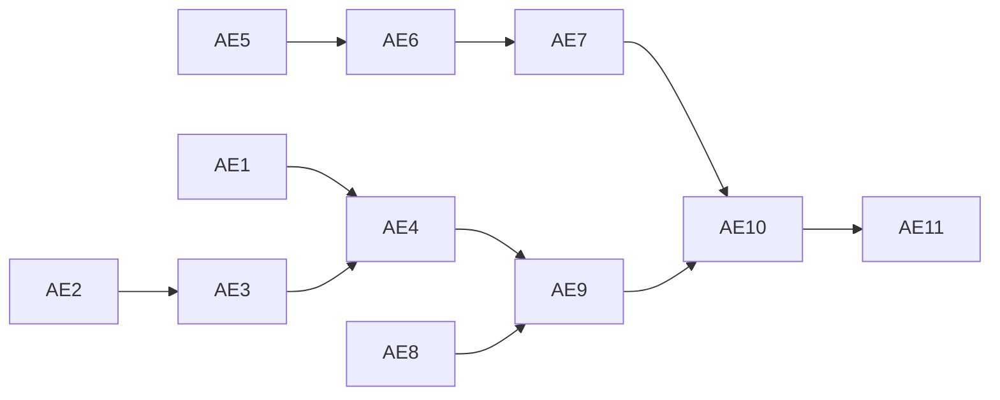

# App profiles and `vyomi env --app` — implementation plan

Estimates assume Claude writes the code and tests and the engineer reviews and runs them. Working days.

## 1. Pull requests

### Appliance (Python)

| PR | Change | Files | Done when | Est. |
| --- | --- | --- | --- | --- |
| AE1 | Endpoint discovery: `GET /api/runtime/endpoints` returns `network` and `published` forms for the simulator (blob), Postgres, Redis and, when present, Service Bus. Network hosts from the canonical env vars (`_CANONICAL_ENV` in `core/appliance_readiness.py`), not hard-coded service names. Published ports from the running containers' port bindings via the Docker client (as `core/backend_provisioner.py` uses it) when the socket is mounted, else configured defaults | new `routes/app_env.py`; registered in `server.py` | Correct values under `docker-compose.yml` + override (Postgres 35432), `docker-compose.appliance.yml` (5432, host `cloudlearn-sql-postgres`) and `docker-compose.cloudlite.yml`; Redis appears only when running | 0.5 |
| AE2 | App state store: generated secrets (alphanumeric, 32 characters) and per-app resource records in SQLite (`VYOMI_APPS_DB`, on the persistent `/data` volume), via the existing `SqliteStateBackend` pattern | new `core/app_state.py` | Secrets stable across restarts; `check_same_thread=False` | 0.25 |
| AE3 | Provision API: `POST /api/runtime/apps/{name}/provision`, **admin key required in every mode** (call `core/admin_auth.verify_admin_key()` directly and return 403 `admin_key_required`; `require_admin_key()` skips the check in developer mode). Parameter grants are `GRANT SET ON PARAMETER … TO …`, never `ALTER ROLE … SET`. Validates the `resources` JSON (extension and parameter allow-lists, identifier validation, quoting), starts needed backends through the existing provisioner, then creates resources: Postgres (role, database, extensions as admin, grants) through the admin connection `core/gcp_sql_engine.py` uses; blob containers through the blob handler's store dispatch (in-process, or `azure_blob_store` when Azurite is configured), with public-access level; Redis via its recipe; Service Bus through `core/azure_servicebus_runtime.py` when it exists, else "not available" | `routes/app_env.py`, new `core/app_provision.py` | Spec §9 tests 2, 10, 11, 12 (idempotent; reports drift; resets a mismatched Postgres password to the stored secret); test 2 in both blob modes | 1.35 |
| AE4 | Resolve API: `POST /api/runtime/apps/{name}/resolve`, **admin key required in every mode** (as AE3). Parses values that mix literal text and `${…}` references (`$${` escapes), fills fields per spec §4 table, generates secrets on first use, percent-encodes values inside URL fields, applies the target, including the blob `host.docker.internal` exception for `--target docker` (spec §4). Unknown references are errors naming the file and key; unavailable resource types are warnings | `core/app_provision.py` | Unit tests for every field and both targets; secrets stable | 0.6 |

### CLI (Go, standard library only)

| PR | Change | Files | Done when | Est. |
| --- | --- | --- | --- | --- |
| AE5 | Subcommand plumbing for `app`, `env`, **`db` and `redis`** (the last two are filled in by storage PG3/PG4 and RD4); `vyomi up --with <profile>` (sets `COMPOSE_PROFILES`); appliance URL from `VYOMI_SIMULATOR_PORT` (default 9000; Multipass VM IP on Max), fixing the hard-coded 9000 in `bridge.go`; a **shared backend-exec helper** used by admin-key retrieval, `db` and `redis`: find a container by compose service (names differ between compose files), run a command in it (`docker exec`, or `multipass exec` then `docker exec`), pass env vars only when non-empty, and copy files in and out (`docker cp`, plus `multipass transfer` on Multipass); admin key obtained by running `get_or_create_admin_key()` inside the simulator container (the key file is lazy and its path varies) and cached in `~/.vyomi/admin_key` (0600) | `cmd/vyomi/dispatch.go`, `cmd/vyomi/bridge.go`, new `cmd/vyomi/app.go`, new `cmd/vyomi/backend_exec.go` | Help lists the new commands; `vyomi up --with app` starts Redis; helper tested against both compose files' names; spec §9 test 13 | 0.75 |
| AE6 | App registry and profile validation: `app add`, `app list`, `app remove`; `~/.vyomi/apps.json`; JSON schema checks with field-level errors | `cmd/vyomi/app.go` | Spec §9 test 1 | 0.25 |
| AE7 | `app provision` and `app status`: POST the resources, print per-resource results | `cmd/vyomi/app.go` | Spec §9 test 2 through the CLI | 0.25 |
| AE8 | Dotenv writer: line-preserving parser (comments, order, quoting, LF/CRLF), in-place replace or managed block, quoting rules, atomic write, `.vyomi.bak`, 0600 for new files, `filepath.FromSlash` on output paths with absolute and `..` paths rejected, git-tracked check (warn if `git` is missing), masked diff | new `cmd/vyomi/dotenv.go` with table-driven tests in `vyomi_test.go` | Spec §9 tests 3 and 8; round-trip tests on sample files with comments and CRLF | 1 |
| AE9 | `vyomi env`: resolve through AE4, choose target, substitute the Multipass VM IP (reuse `multipass.go`), write with AE8; `--dry-run`, `--check`, `--show-secrets` | `cmd/vyomi/env.go` | Spec §9 tests 4, 4a, 5, 6, 6a | 0.5 |

### Siftly and end-to-end

| PR | Change | Done when | Est. |
| --- | --- | --- | --- |
| AE10 | Siftly profile: `.vyomi/app.json` in Siftly's repo with its real container names, database (extensions `vector` and `uuid-ossp`, parameter `session_replication_role`), Redis and Service Bus entities and the three output files (a PR to Siftly), plus a copy in Vyomi `samples/` as a reference app. Blob is configured **only** through the connection-string variables, never `AZURE_STORAGE_ACCOUNT_NAME`/`KEY` alone (Siftly falls back to the Azure host name with those) | `vyomi app add` accepts it | 0.25 |
| AE11 | End-to-end and cross-platform: run on macOS (Docker Desktop), Linux and Windows; Multipass; Siftly backend, Hocuspocus and content engine boot | Spec §9 tests 7 and 9 | 0.75 |
| | **Total** | | **~6.5 d** (solo ~11 d) |

## 2. Order

The appliance track (AE1–AE4) and the CLI track (AE5–AE8) can run in parallel. AE8, the dotenv writer, has no dependencies and can start first.

## 3. Effect on the other plans

These changes are already applied in the other files.

| Plan | Item | Status |
| --- | --- | --- |
| `storage-cache-siftly-implementation-plan.md` | CL1 (CLI plumbing) | Removed; done once in AE5, which also covers `db` and `redis` dispatch and the shared exec helper |
| | EN1 (`vyomi env --map`) | Removed; replaced by this plan |
| | PG3 | Now `vyomi db dump` and `vyomi db refresh` only; role, database, extensions and grant come from AE3 |
| | PG4 (`vyomi db restore`) | Depends on AE3 (provisioned role and extensions) and the AE5 exec helper |
| | RD2, RD4 | RD2 unchanged by this plan (AE3 starts Redis through its recipe); RD4 uses the AE5 exec helper |
| | BL3 | Public-access level stored by BL3 is what AE3 sets |
| `servicebus-siftly-implementation-plan.md` | A5 entities file | **Replaced** by the profile's `servicebus` resources; A5 keeps the runtime store, persistence and console work |
| | B7 env step | Replaced by `vyomi env` with the `servicebus` connection string field |

**Net effect:** the storage plan dropped about 1.5 days of CLI and env work (EN1 1 d, CL1 0.25 d, about 0.25 d of PG3), and the Service Bus plan drops about 0.25 day (the entities loader). Against this plan's 6.5 days, the app-profile work adds about 4.75 days overall.

## 4. Risks

| Risk | Effect | Mitigation |
| --- | --- | --- |
| Published ports differ by compose file and override | Wrong host ports in `.env` | AE1 reads the running project, not the files |
| Dotenv edge cases (multi-line values, `export` prefixes, inline comments) | Corrupted files | AE8 table tests; unsupported lines are left untouched and reported |
| Secrets leaking into git | Credential exposure | Git-tracked check; masked output; 0600 files |
| Dockerised app's blob URLs do not load in the browser | Broken images | `host.docker.internal` endpoint for the Docker target; `--check` warning |
| Profile format churn | Apps must update profiles | `"version": 1` field reserved; validation errors explain changes |
| Service Bus not ready when this ships | Partial env | Warn and skip unavailable resource types (spec §4) |
| Secrets exposed on the LAN | Credential leak | Admin key on `provision` and `resolve` (AE3, AE4) |
| A profile from another repo runs SQL as superuser | Privilege abuse | Allow-lists and identifier validation in AE3 |

## 5. Out of scope

YAML profiles, Kubernetes and Compose outputs, Key Vault output, running app processes.

## 6. Review log

| Date | Finding | Change |
| --- | --- | --- |
| 2026-10-18 | Secret-returning APIs unauthenticated on 0.0.0.0:9000 | Admin key on AE3, AE4; CLI key retrieval in AE5 |
| 2026-10-18 | Raw `grants` SQL from profiles | Allow-lists and identifier validation in AE3 |
| 2026-10-18 | Hard-coded service names and port 9000 | AE1 uses canonical env vars; AE5 honours `VYOMI_SIMULATOR_PORT` |
| 2026-10-18 | State reset orphans Postgres passwords | AE3 resets to the stored secret |
| 2026-10-18 | URL-unsafe secrets | Alphanumeric secrets; percent-encoding in AE4 |
| 2026-10-18 | Net-effect arithmetic understated the dropped work | Corrected to ~1.5 d dropped from the storage plan |
| 2026-10-18 | Estimate | 5.5 → 6 days with Claude (AE3 +0.25, AE5 +0.25) |
| 2026-10-18 | AE5 covered only `app` and `env`, but storage PG3/PG4/RD4 need `db`, `redis` and an exec helper (container lookup, Multipass, file copy, empty-env handling) | AE5 extended (+0.25 d) |
| 2026-10-18 | Blob containers would bypass Azurite; Docker-target blob URLs | AE3 uses the handler's store dispatch (+0.1 d); AE4 applies the `host.docker.internal` exception (+0.1 d) |
| 2026-10-18 | Section 3 still described CL1, EN1 and PG3 as pending changes | Rewritten as applied status; net effect recomputed |
| 2026-10-18 | Siftly profile details | AE10 lists `uuid-ossp` and the connection-string-only rule |
| 2026-10-18 | Estimate | 6 → 6.5 days with Claude (solo 10 → 11) |
| 2026-10-18 | External review (6 items): 403 not 401; developer-mode auth bypass; `GRANT SET ON PARAMETER` DDL; `"version": 1`; Hocuspocus SSL; Windows paths | All applied except the SSL item, which did not apply to Siftly (`node-postgres` has no SSL by default); mixed literal/expression values added for apps that need it. Also: key retrieval via `get_or_create_admin_key()` (lazy file, variable path). No estimate change |
