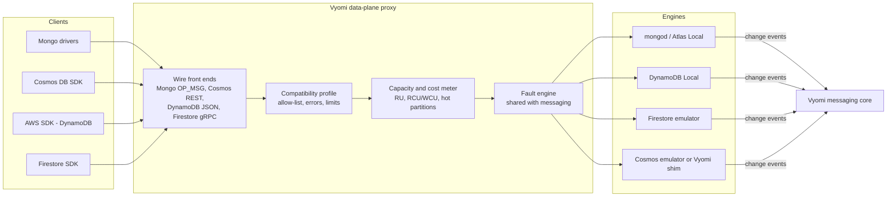

# Vyomi Document Stores — multi-cloud spec

Unlike messaging, good local engines already exist for most document stores: `mongod`, MongoDB Atlas Local, DynamoDB Local, the Firestore emulator and the Cosmos DB emulator. Vyomi should **not** rebuild those engines. It should put one protocol-aware **data-plane proxy** in front of them. The proxy adds what none of them do: production compatibility rules, capacity and cost simulation, fault injection, and change events into the messaging core. Vyomi builds its own engine only where no usable local engine exists.

The most common failure these products cause is "it worked on local Mongo and broke on DocumentDB or Cosmos DB". A compatibility profile that rejects what production rejects is the first feature to build.

## 1. Goals and non-goals

**Goals**

- Official SDKs and drivers connect by endpoint or connection-string change only.
- One proxy and one profile system for MongoDB, Azure Cosmos DB, Amazon DynamoDB and DocumentDB, and Google Firestore.
- Production-accurate compatibility: an operator, stage or index the target cloud does not support fails locally with the same error.
- Capacity simulation: request units, read and write capacity units, hot partitions, and throttling with the native retry signals.
- Change events (change streams, change feed, DynamoDB Streams, Firestore triggers) delivered into the Vyomi messaging core.
- Shared faults, virtual clock, snapshots and pseudonymized seed data with the rest of Vyomi.

**Non-goals**

- Reimplementing a storage engine where a local one is good enough.
- Matching production latency at scale.
- Cassandra, Gremlin and Table APIs of Cosmos DB, Bigtable and Keyspaces. They are wide-column or graph stores, with their own spec later.

## 2. The common model

| Primitive | MongoDB Atlas | Azure Cosmos DB | AWS | GCP |
| --- | --- | --- | --- | --- |
| Products | MongoDB Atlas, self-hosted MongoDB | Cosmos DB for NoSQL; Cosmos DB for MongoDB (RU and vCore) | DynamoDB; DocumentDB (MongoDB-compatible) | Firestore native mode; Firestore with MongoDB compatibility |
| Container | Database → collection | Database → container | Table | Collection, with subcollections |
| Identity | `_id` | `id` + partition key | Partition key (+ sort key) | Document path |
| Partitioning | Shard key | Partition key, logical partitions | Partition key, adaptive capacity | Automatic, with hotspot limits |
| Query | MQL and aggregation pipeline | SQL-like over JSON | Key-condition queries, Scan, PartiQL | Structured queries; composite indexes required |
| Indexes | Declared | Automatic by default, indexing policy | Primary key, GSI and LSI | Single-field automatic, composite declared |
| Change events | Change streams | Change feed | DynamoDB Streams | Listeners; triggers through Eventarc / Functions |
| TTL | TTL index | Per-item `ttl` | TTL attribute | TTL policy |
| Transactions | Multi-document ACID | Transactional batch within one partition key | `TransactWriteItems` | Transactions |
| Capacity model | Cluster tier | RU/s (provisioned, autoscale, serverless) | RCU and WCU, or on-demand | Per-document write rate, ramp-up rule |
| Throttle signal | n/a (latency) | HTTP 429 + `x-ms-retry-after-ms` | `ProvisionedThroughputExceededException` | `RESOURCE_EXHAUSTED` |
| Wire protocol | Mongo wire (OP_MSG, BSON) | HTTPS REST; Mongo wire for the Mongo API | HTTPS, AWS JSON 1.0 | gRPC; Mongo wire for Mongo compatibility |
| Official local option | `mongod`; Atlas Local image (adds Search) | Cosmos DB emulator (Windows; Linux image) | DynamoDB Local; none for DocumentDB | Firestore emulator (Firebase CLI / gcloud) |

Figures and limits in this spec are from memory and **must be verified against each provider's current documentation** before conformance tests are written.

Two engine families cover almost everything:

- **Mongo family.** Atlas, DocumentDB, Cosmos DB for MongoDB, and Firestore with MongoDB compatibility all speak the Mongo wire protocol. One `mongod` plus a per-target compatibility profile covers four cloud products.
- **Key-value document family.** DynamoDB, Cosmos DB for NoSQL and Firestore native each have their own API and need their own engine or emulator.

## 3. Architecture



Each request passes through four stages:

1. **Front end** parses the wire format (BSON over OP_MSG, Cosmos REST, DynamoDB JSON, Firestore gRPC) into a command.
2. **Compatibility profile** checks the command against the target's allow-list and limits. A rejected command returns the target's native error without reaching the engine.
3. **Capacity meter** charges the command (request units, capacity units or write rate) against the configured budget. Over budget, it returns the native throttle signal.
4. **Fault engine** applies scheduled faults, then forwards to the engine.

Responses come back the same way. The meter adds native cost headers, such as Cosmos DB's `x-ms-request-charge` and DynamoDB's `ConsumedCapacity`.

## 4. Engines per target

| Target | Engine | Vyomi adds | Milestone |
| --- | --- | --- | --- |
| MongoDB / Atlas | `mongod`; Atlas Local image when Search or Vector Search is used | Faults, step-down and failover, seed data | M1 |
| Amazon DocumentDB | `mongod` | DocumentDB profile: unsupported operators, stages and index types; version-specific | M1 |
| Cosmos DB for MongoDB | `mongod` | Cosmos Mongo profile (RU and vCore variants); RU charge and 429s for the RU variant | M1 |
| Firestore with MongoDB compatibility | `mongod` | Firestore-Mongo profile | M1 |
| DynamoDB | DynamoDB Local | Capacity units by item size, throttling, hot partitions, Streams into messaging core, TTL deletion on the virtual clock | M2 |
| Cosmos DB for NoSQL | Official emulator; evaluate a Vyomi shim on Postgres JSONB if the emulator is too heavy or platform-limited | RU charge, 429s, partition limits, change feed into messaging core | M3 |
| Firestore native | Firestore emulator | Write-rate and ramp-up limits, composite-index-required errors, triggers into messaging core | M4 |

An alternative Mongo-family engine is FerretDB on Microsoft's open-source DocumentDB Postgres extension. It keeps everything on Postgres, which suits teams already seeding Postgres through Vyomi. Default to `mongod` for fidelity, and keep this as an option.

## 5. Compatibility profiles

A profile is data: which commands, operators, aggregation stages, index types and options a target supports, at which version, and the exact error each refusal returns.

```yaml
# profiles/documentdb-5.0.yaml (illustrative; fill from AWS compatibility docs)
target: aws-documentdb
version: "5.0"
wire: mongo
reject:
  aggregation_stages: [$graphLookup, $facet]    # example entries only
  operators: []
  index_types: []
limits:
  max_document_bytes: 16777216
errors:
  unsupported: { code: 303, message: "Feature not supported: {feature}" }   # verify code
```

- Profiles are versioned with the target (DocumentDB 4.0 vs 5.0, Cosmos Mongo 4.2 vs vCore).
- `vyomi db lint` replays a recorded workload, or scans code for query shapes, against a profile and lists what will break before deploy. This is the first paid feature and a strong demo.
- Profiles are built from each provider's published compatibility list and then confirmed by the nightly conformance run (section 9).

## 6. Capacity and cost simulation

| Target | What is metered | Over budget |
| --- | --- | --- |
| Cosmos DB | RU per operation, from a cost model of document size, index use and query shape; per-partition and total RU/s | 429 with `x-ms-retry-after-ms`; SDK retries as in production |
| DynamoDB | RCU/WCU by item size and consistency; per-partition limits; adaptive capacity on/off | `ProvisionedThroughputExceededException`; on-demand mode only throttles hot partitions |
| Firestore | Writes per document per second; ramp-up rule for new collections | `RESOURCE_EXHAUSTED` / contention errors |
| Mongo family | Optional ops-per-second ceiling per tier | Added latency, then timeouts |

Every test run ends with a cost report: operations and capacity consumed per collection, projected to a monthly figure at a stated production multiplier. Enterprise buyers use this to catch an expensive query before it ships.

## 7. Faults

| Fault | Effect | Native signal |
| --- | --- | --- |
| `throttle` | Force over-budget responses | 429 / `ProvisionedThroughputExceededException` / `RESOURCE_EXHAUSTED` |
| `step-down` | Primary steps down mid-operation (Mongo family) | `NotWritablePrimary`; retryable writes must succeed |
| `failover` | Region or replica failover | Connection reset, then new primary |
| `latency` | Slow responses with p50 and p99 | Timeouts against real budgets |
| `transient` | Random retryable errors | Each SDK's retry path |
| `partition-split` | Cosmos partition split | Gone / partition-key-range errors the SDK must handle |
| `stale-read` | Eventual read returns an older version | DynamoDB eventually consistent read, Cosmos session/eventual |
| `conflict` | Concurrent write conflict | Write conflict, `ConditionalCheckFailedException`, `ABORTED` |

Faults share the scenario format, seed and virtual clock with the messaging core, so one scenario can throttle a database and drop message leases together.

## 8. Change events and data

- **Change events.** Change streams, the change feed, DynamoDB Streams and Firestore document triggers are published to topics in the messaging core. A Lambda-, Function- or worker-style consumer can then be tested locally against the same lease and fault rules.
- **Seed data.** The pseudonymization and FK-aware subsetting pipeline from the Postgres seed work extends to documents. Pseudonymization uses keyed, consistent mapping across fields and embedded text. Embedded vectors are recomputed.
- **Snapshots.** `vyomi snapshot save` captures engine state and proxy state (capacity counters, profiles) together with messaging state.

## 9. Conformance

- Each target runs the official driver or SDK samples in CI.
- Each compatibility profile has a test that sends one unsupported feature per entry and checks the error matches the profile.
- A nightly job runs the same workload against real Atlas, DocumentDB, Cosmos DB, DynamoDB and Firestore accounts. It diffs results, errors and charged capacity (RU, RCU/WCU). Drift fails the build and updates the profile backlog.

## 10. Milestones

| Milestone | Scope | Gate |
| --- | --- | --- |
| M1 | Mongo wire proxy; `mongod` and Atlas Local; profiles for DocumentDB, Cosmos Mongo and Firestore-Mongo; faults; `vyomi db lint` | Profile conformance passes for all four Mongo targets |
| M2 | DynamoDB: proxy over DynamoDB Local, capacity units, throttling, Streams into messaging core | AWS SDK samples pass; capacity charges match a real table within a set tolerance |
| M3 | Cosmos DB for NoSQL: emulator or shim decision, RU model, 429s, change feed | Cosmos SDK retries on 429 as in production; RU within tolerance |
| M4 | Firestore native: emulator wrap, write-rate limits, triggers into messaging core | Firestore client samples pass |

## 11. Prioritization note

Siftly does not use a document store; it keeps JSON in Postgres JSONB. Before building past M1, find two or three target repos that do. Ask:

- Which document stores run in production, and which do developers use locally?
- Has a query worked locally and failed in production on compatibility? How often?
- Has a throttling bill or 429 storm reached production?
- Do functions or workers consume change events, and how are they tested today?

If the answers centre on DynamoDB, swap M1 and M2.

## 12. Open questions and risks

- [ ] **Licensing.** Bundling `mongod` (SSPL), DynamoDB Local and the Cosmos DB emulator inside a commercial appliance needs legal review. The fallback is to pull official images at install time rather than redistribute them.
- [ ] **RU cost model accuracy.** Cosmos RU charges depend on internals. Calibrate from real `x-ms-request-charge` values gathered by the nightly run.
- [ ] **Cosmos NoSQL engine.** Emulator or Postgres JSONB shim? Decide at M3 based on emulator weight and platform support.
- [ ] **Profile upkeep.** Providers change compatibility often. Each profile needs an owner and the nightly diff.
- [ ] **Search and vector.** Atlas Search, Cosmos vector search and DynamoDB zero-ETL to OpenSearch overlap with the AI Search emulator. Decide which spec owns them.
