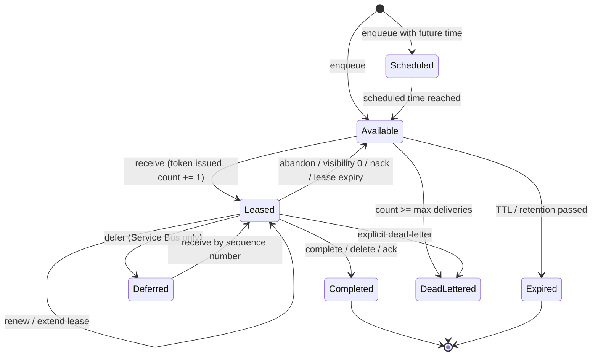

# Vyomi Messaging Core — multi-cloud spec

Vyomi emulates Azure Service Bus, AWS SQS and SNS, and GCP Pub/Sub. The target design is **one lease-queue core** and **three thin protocol adapters**. A per-cloud profile supplies defaults, limits and error codes. Faults, the virtual clock, storage and snapshots live in the core, so a fault scenario written once runs against an app on any of the three clouds. No single-cloud emulator can do that, and it is the reason Vyomi is a multi-cloud product rather than a bundle of emulators. Vyomi reaches that design in steps: it first wraps each cloud's own emulator behind a protocol-aware proxy (M0), and builds the own core only when the trigger in the Decision section fires.

The Service Bus adapter is specified in detail in the Docs spec linked above. This document defines the shared core and the AWS and GCP adapters.

## Decision: wrap each cloud's own emulator first, build on a trigger

**Decision (2026-10-17, revised the same day):** in M0, Vyomi wraps **each cloud's own emulator** behind a **protocol-aware fault proxy**. It builds the own core (sections 2–8) only when the trigger below fires.

Running an emulator costs almost nothing: it is one process for one user, mostly in memory, with no high-availability or durability promises. The real cost is building and maintaining one, mostly in protocol adapters. So that money is spent only once demand for what wrapping cannot do is proven.

### Why not one emulator behind every cloud

Using the Microsoft Service Bus emulator as the engine behind SQS, SNS and Pub/Sub was considered and rejected. Their semantics do not fit Service Bus, so the translation layer would have to rebuild most of a broker anyway, inside Service Bus's limits.

| AWS / GCP behaviour | Fits Service Bus? | Reason |
| --- | --- | --- |
| SQS `ChangeMessageVisibility`, any value 0 s–12 h | No | Service Bus renews by a fixed lock duration, max 5 min |
| Pub/Sub `ModifyAckDeadline` per message, 0–600 s | No | Same |
| SQS DLQ as a normal queue, with redrive back | Partial | Service Bus dead-letters into a built-in subqueue; no direct redrive |
| SQS FIFO groups, content-based dedup | Partial | Sessions need a session lock per receiver; no body-hash dedup |
| SNS filter policies, including filtering on the body | Partial / no | Service Bus filters only look at properties |
| SNS HTTP/Lambda delivery, Pub/Sub push | No | No push delivery in Service Bus |
| Pub/Sub seek, snapshots, keeping acked messages | No | Completed messages are gone |
| Pub/Sub schemas | No | Not in Service Bus |
| Message size: SQS 1 MiB, Pub/Sub 10 MB | No | Emulator follows Standard tier, 256 KB |
| Typed SQS attributes | Lossy | Data types do not survive the mapping |
| `CreateQueue` / `CreateTopic` at runtime | Doubtful | Early emulator releases read entities from config at start-up. Verify |

### M0 engines

| Cloud | Engine wrapped | Client finds it through |
| --- | --- | --- |
| Azure Service Bus | Microsoft Service Bus emulator | Connection string with `UseDevelopmentEmulator=true` |
| AWS SQS + SNS | ElasticMQ (SQS) or LocalStack (SQS + SNS) | `AWS_ENDPOINT_URL_SQS`, `AWS_ENDPOINT_URL_SNS` |
| GCP Pub/Sub | Google Pub/Sub emulator | `PUBSUB_EMULATOR_HOST` |

Vyomi owns the layer above all three: one topology file (section 7), `vyomi env`, the fault proxy, CLI and console, snapshots and scenarios. That layer is what makes the product multi-cloud. The engines underneath do not need to be the same.

### What a protocol-aware proxy can fake

The proxy understands each wire protocol, not just TCP, so it can rewrite requests and responses. That covers more message-level faults than a network proxy can.

| Fault | SQS (HTTP) | Pub/Sub (gRPC) | Service Bus (AMQP) |
| --- | --- | --- | --- |
| Latency, disconnect, throttle | Yes | Yes | Yes (detach, refuse attach) |
| Lost lease | Inject `ChangeMessageVisibility` 0 | Inject `ModifyAckDeadline` 0 | Hold the settlement until the lock expires |
| Lost settle → redelivery | Drop `DeleteMessage` | Drop `Acknowledge` | Drop the disposition |
| Duplicate delivery | Repeat a message in `ReceiveMessage` | Repeat a message in `StreamingPull` | Hard; not in M0 |
| Poison message | Send through the real API | Same | Same |
| Virtual clock | **No** | **No** | **No** |

Wrapping therefore gives AWS and GCP better fault coverage than Service Bus. No wrapping approach gives a virtual clock, because timers inside a wrapped engine run in real time.

### M0 gate

- Siftly A1, A3 (via held settlement), A5, A8 and A9 pass on the wrapped Service Bus emulator.
- AWS and GCP SDK samples (send, receive, settle, dead-letter) pass on ElasticMQ/LocalStack and the Pub/Sub emulator, with lost-lease, lost-settle and duplicate faults injected by the proxy.

### Trigger to build the own core

Start building the own core when **any two** of these hold:

1. Three or more design partners need the **virtual clock** (lock-expiry and TTL tests in seconds) or per-message faults the proxy cannot fake on Service Bus.
2. Customers need **identical fault behaviour across clouds**, for example one scenario run against Service Bus and SQS with the same results.
3. A wrapped engine blocks a needed feature or platform (ARM laptops, start-up time, runtime entity creation), with no fix scheduled upstream.
4. A wrapped engine's licence does not allow use in a commercial product.

When the trigger fires, build in this order: core and store, then the SQS/SNS adapter (cheap, proves the shared core), then Pub/Sub, then replace the wrapped Service Bus emulator with the own AMQP adapter.

### Check before M0

- [ ] **Licences** of the Microsoft Service Bus emulator, ElasticMQ (Apache 2.0), LocalStack and the Google Pub/Sub emulator for use inside a commercial product. If redistribution is not allowed, pull official images at install time.
- [ ] **Proxy reach** per fault and SDK: confirm each rewrite in the table above leaves the SDK in a valid state.
- [ ] **Runtime entity creation** in the Microsoft emulator's current release.

### Why this is safe

The paid value is the control plane: `vyomi env`, scenarios, snapshots, traces and cross-service runs. None of it depends on owning a broker. If a cloud vendor adds fault injection to its emulator, M0 costs weeks, not months of broker work.

## 1. Goals and non-goals

**Goals**

- Unmodified official SDKs connect by endpoint or connection-string change only.
- One behavioural model for leases, settlement, redelivery and dead-lettering across clouds.
- Faults, load scenarios and the virtual clock are cloud-neutral and map to each cloud's native errors.
- One topology file declares entities for all three clouds.
- Single binary, cold start under 2 s, under 150 MB with an empty topology.

**Non-goals**

- Event streams (Event Hubs, Kinesis, MSK, Pub/Sub Lite). They are log-based and need a separate log core.
- Event routers (Event Grid, EventBridge, Eventarc). They can be layered on this core later.
- Matching absolute cloud throughput or latency.
- Real IAM, RBAC or Entra ID evaluation. Credentials are checked only for shape, or accepted in open mode.

## 2. The canonical model

Every cloud's queueing product reduces to these entities.

| Entity | Fields | Notes |
| --- | --- | --- |
| Namespace | name, cloud, region, profile | One per Service Bus namespace, AWS account and region, or GCP project |
| Topic | name, retention, dedup window, ordering mode | SB topic, SNS topic, Pub/Sub topic |
| Subscription | name, topic, filter, lease duration, max deliveries, DLQ target, retention, delivery mode (pull or push) | SB subscription, SQS queue subscribed to SNS, Pub/Sub subscription. A plain queue is a topic with exactly one subscription |
| Message | id, sequence number, body (bytes), attributes, content type, correlation id, ordering key, dedup id, enqueue time, scheduled time, expiry, delivery count | One immutable record per topic; per-subscription delivery state is separate |
| Delivery | message, subscription, state, lease token, lease expiry, delivery count, last error | The unit the lease state machine acts on |
| Lease token | opaque, per delivery attempt | SB lock token, SQS receipt handle, Pub/Sub ack id |

### Delivery state machine



Rules the core enforces for every cloud:

1. A settle or extend call with a token from an earlier attempt fails. Each cloud reports that failure in its own way (section 5).
2. Delivery count rises on every lease, not on every receive call.
3. With an ordering mode set, at most one delivery per ordering group is leased at a time. Ordering groups are SB sessions, SQS FIFO message groups and Pub/Sub ordering keys.
4. All time-based transitions read the virtual clock.

## 3. Cloud mapping

| Primitive | Azure Service Bus | AWS SQS + SNS | GCP Pub/Sub |
| --- | --- | --- | --- |
| Fan-out | Topic → subscriptions | SNS topic → SQS queues | Topic → subscriptions |
| Point-to-point | Queue | SQS queue | Topic with one subscription |
| Lease | Peek-lock | Visibility timeout | Ack deadline |
| Extend lease | Renew lock | `ChangeMessageVisibility` | `ModifyAckDeadline` |
| Release | Abandon | Visibility 0 | Nack (`ModifyAckDeadline` 0) |
| Complete | Complete | `DeleteMessage` | `Acknowledge` |
| Dead-letter | `maxDeliveryCount`, built-in DLQ subqueue | Redrive policy, `maxReceiveCount`, separate queue | Dead-letter policy, separate topic |
| Ordering | Sessions | FIFO queue, `MessageGroupId` | Ordering keys |
| Dedup | Duplicate detection window | FIFO `MessageDeduplicationId` | Exactly-once delivery (ack-id based) |
| Delay | Scheduled enqueue | `DelaySeconds` | Not native |
| Filters | SQL and correlation rules | SNS filter policies | Subscription filter expressions |
| Push | Not native | SNS → HTTP(S), Lambda | Push subscriptions |
| Wire protocol | AMQP 1.0 | HTTPS, AWS JSON 1.0 (SQS), Query/XML (SNS) | gRPC `google.pubsub.v1`, REST |

## 4. Adapters

| Adapter | How clients reach it | Implementation notes |
| --- | --- | --- |
| Service Bus | Connection string with `UseDevelopmentEmulator=true`, AMQP on 5672 or 5671 | See the Docs spec. `$cbs` auth, `$management` node, AMQP dispositions |
| SQS | `AWS_ENDPOINT_URL_SQS` or `AWS_ENDPOINT_URL`, or `endpoint_url` in code | Plain HTTP. Support AWS JSON 1.0 (`X-Amz-Target: AmazonSQS.*`) and the older Query protocol for old SDKs. Accept SigV4 without verifying it in open mode |
| SNS | `AWS_ENDPOINT_URL_SNS` | Query protocol with XML responses. `Publish` writes to the topic; SQS subscriptions become core subscriptions; non-raw delivery wraps the body in the SNS JSON envelope. HTTP subscriptions use the push dispatcher, including the confirmation handshake |
| Pub/Sub | `PUBSUB_EMULATOR_HOST`, which Google client libraries already honour | gRPC server from the published `googleapis` protos. `StreamingPull` is the hot path. Push subscriptions use the push dispatcher |

### Push dispatcher

One shared component delivers to HTTP endpoints for SNS HTTP subscriptions and Pub/Sub push subscriptions. It leases a delivery, POSTs it, treats a 2xx as complete and anything else as release, and retries with the cloud's backoff profile. Faults can make it slow or fail like the real service.

## 5. Per-cloud profiles

A profile is data, not code. It sets defaults, limits and how each core outcome becomes a native error. Values below are working assumptions taken from memory and **must be checked against each cloud's current quota page** before M1 conformance tests are written.

| Setting | Service Bus Standard | SQS | Pub/Sub |
| --- | --- | --- | --- |
| Max message size | 256 KB (Premium 100 MB) | 1 MiB | 10 MB |
| Default lease | 60 s | 30 s | 10 s |
| Max lease | 5 min | 12 h | 600 s |
| Default max deliveries | 10 | Set by redrive policy | Set by dead-letter policy, 5–100 |
| Retention | Per-entity TTL | 4 days default, up to 14 | 7 days default |
| Max delay | Unlimited (scheduled) | 15 min | n/a |

| Core outcome | Service Bus | SQS | Pub/Sub |
| --- | --- | --- | --- |
| Stale lease token | `com.microsoft:message-lock-lost` | Receipt handle error (verify exact behaviour) | Exactly-once: ack fails with invalid ack id; otherwise ignored |
| Throttled | `com.microsoft:server-busy` | `ThrottlingException` / `RequestThrottled` | `RESOURCE_EXHAUSTED` |
| Unavailable | Link or connection detach | HTTP 5xx `ServiceUnavailable` | `UNAVAILABLE` |
| Too large | `amqp:link:message-size-exceeded` | `InvalidParameterValue` | `INVALID_ARGUMENT` |
| Not found | `amqp:not-found` | `QueueDoesNotExist` | `NOT_FOUND` |

## 6. Faults, clock and load

Faults are defined once against core outcomes and rendered through the profile.

| Fault | Core effect | Seen as |
| --- | --- | --- |
| `lease-lost` | Invalidate the current token | Lock lost / receipt invalid / ack failure |
| `extend-fail` | Extend calls fail N times | Renew or visibility change fails |
| `throttle` | Reject sends and receives for a duration | Native throttling error |
| `disconnect` | Drop connections or streams | AMQP detach / HTTP 5xx / gRPC `UNAVAILABLE` |
| `latency` | Add delay with p50 and p99 | Slow calls |
| `duplicate` | Redeliver a completed message | At-least-once duplicate |
| `poison` | Enqueue a malformed body | Repeated failure, then dead-letter |
| `push-fail` | Push target returns errors | SNS / Pub/Sub push retries |

Scenario files, the virtual clock and load profiles follow the Docs spec unchanged. Entity paths in a scenario carry the cloud prefix, for example `azure://siftlyai/scrapper_responses/scrapper_responses` or `aws://000000000000/us-east-1/orders`.

## 7. Topology file

```yaml
# vyomi.messaging.yaml
azure:
  - namespace: siftlyai
    tier: standard
    env: { connectionString: AZURE_SERVICEBUS_CONNECTION_STRING }
    topics:
      - name: scrapper_responses
        subscriptions: [{ name: scrapper_responses, lockDuration: PT60S, maxDeliveryCount: 10 }]
aws:
  - account: "000000000000"
    region: us-east-1
    env: { endpoint: AWS_ENDPOINT_URL }
    sqs:
      - { name: orders, visibilityTimeout: 30, redrive: { target: orders-dlq, maxReceiveCount: 5 } }
      - { name: orders-dlq }
    sns:
      - { name: order-events, subscriptions: [{ protocol: sqs, endpoint: orders, raw: true }] }
gcp:
  - project: demo-project
    env: { emulatorHost: PUBSUB_EMULATOR_HOST }
    topics:
      - name: order-events
        subscriptions: [{ name: billing, ackDeadlineSeconds: 10, deadLetter: { topic: order-events-dlq, maxDeliveryAttempts: 5 } }]
```

## 8. Runtime and storage

- **Own core, once the trigger fires (see Decision).** Kafka and Redpanda lack per-message leases. RabbitMQ 4 speaks AMQP 1.0 but lacks lock tokens, renewal, sequence-number operations, scheduling and deferral. Adapting either costs more than writing the state machine above.
- **Store.** In memory by default. `--persist` uses an embedded write-ahead store (SQLite in WAL mode or RocksDB). Snapshots capture messages, deliveries and leases.
- **Protocol libraries.** AMQP 1.0 server: `fe2o3-amqp` (Rust, acceptor feature) or `Microsoft.Azure.Amqp` (.NET). SQS and SNS: plain HTTP handlers. Pub/Sub: gRPC generated from `googleapis`.
- **Language.** Open question: Rust (fe2o3-amqp, small binary) or Go (strong gRPC and HTTP, weaker AMQP 1.0 server options).

## 9. Conformance

- Each adapter runs the official SDK samples for its cloud (send, receive, settle, extend, dead-letter) in CI.
- A nightly job runs the same scenario against a real Service Bus namespace, a real SQS and SNS account and a real Pub/Sub project, and compares delivery traces. Drift fails the build.
- Siftly acceptance tests A1–A9 (Docs spec) gate the Service Bus adapter.

## 10. Milestones

| Milestone | Scope | Gate |
| --- | --- | --- |
| M0 | Wrap each cloud's own emulator (Service Bus emulator, ElasticMQ/LocalStack, Pub/Sub emulator) behind a protocol-aware fault proxy; one topology file; `vyomi env` (see Decision) | Siftly A1, A3, A5, A8, A9 pass; AWS and GCP SDK samples pass with proxy faults |
| M1 (after trigger) | Core state machine, store, faults, clock; SQS/SNS adapter first to prove the core | AWS SDK samples pass; lease faults reproducible |
| M2 | Own Service Bus AMQP adapter replaces the wrapped emulator (Docs spec M1 scope) | Siftly A1–A9 pass, including lock loss and drain |
| M3 | Pub/Sub adapter: pull, StreamingPull, dead-letter policy, filters | Google client samples pass; nightly trace diff clean |
| M4 | Push dispatcher (SNS HTTP, Pub/Sub push); ordering across clouds (SB sessions, SQS FIFO, ordering keys); dedup and exactly-once | Ordering and dedup conformance across all three |

## 11. Open questions

- [ ] Rust or Go for the core?
- [ ] Exact stale-receipt-handle behaviour for SQS `DeleteMessage` and `ChangeMessageVisibility`. Verify against a real account.
- [ ] Should SNS FIFO topics land in M2 or M4?
- [ ] Do we need the SQS Query protocol, or are all target SDKs on AWS JSON 1.0?
- [ ] Is the free tier one cloud adapter, or all three without faults?
