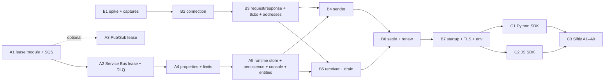

# Azure Service Bus for Siftly — implementation plan

This plan turns `servicebus-siftly-plan.md` (the spec) into pull requests. It is based on reading `core/messaging_store.py`, `core/sqs_core.py`, `core/azure_servicebus_core.py`, `core/gcp_pubsub_core.py`, `core/aws_wire_router.py`, `core/wire_ingress.py`, `core/persistent_store.py`, `core/console_azure_servicebus.py` and the messaging conformance scripts.

**Done means:** Siftly's backend workers (`azure-servicebus` 7.14.3, Python) and `traffic-ingest-service` (`@azure/service-bus` 7.9, JavaScript) run against Vyomi with only a connection-string change and `ENVIRONMENT=local`, and Siftly acceptance tests A1–A9 pass in CI.

**Revision 2 (2026-10-17)** applies a design review. Changes: SQLite thread safety, coalesced persistence, console rewiring, link-pair request/response for `$cbs` and `$management`, drain handling, required message annotations, a fuller lease API, the dead-letter queue as a real sub-queue, Pub/Sub moved off the critical path, and a narrower A5. See section 9.

## 1. Current code, in brief

| Piece | Where | Relevant facts |
| --- | --- | --- |
| Store seam | `core/messaging_store.py` | `queues` and `topics` dicts; controllable clock (`now`, `set_time`, `advance`); `persist()` hook. Pure Python, runs in Pyodide |
| SQS core | `core/sqs_core.py` | The only lease model: `visible_at`, `receive_count`, `receipt_handle`, `in_flight`, `deleted`; `_redrive_expired` moves to the DLQ at receive time; FIFO group locking. `ChangeMessageVisibility` matches the receipt handle only and never checks expiry |
| Service Bus core | `core/azure_servicebus_core.py` | REST wire. Subscriptions hold `messages` lists. Lock is `_locked = <uuid>` with **no expiry**; no delivery count; no dead-letter; no renew |
| Pub/Sub core | `core/gcp_pubsub_core.py` | Subscriptions live in `store.queues`; pull sets `_pending=True` with an ack id and **no deadline** |
| Persistence | `core/persistent_store.py` | `SqliteStateBackend` opens `sqlite3.connect(path)` (default `check_same_thread=True`, line 67). `persist()` → `_save()` serializes the **entire** store (all topics, all messages, bodies base64) on every mutation |
| Service Bus wiring | `core/aws_wire_router.py` (`az_sb`), `core/wire_ingress.py` | Backed by `PersistentMessagingStore` on SQLite (`VYOMI_AZSB_DB`). Mounted only with `VYOMI_UNIFIED_INGRESS=1`, and in Nano. `ahandle` runs the synchronous core on the event-loop thread |
| Service Bus console | `core/console_azure_servicebus.py` | Its own private `_QUEUES` / `_TOPICS` dicts; does not see the REST store |
| Config file | — | No `vyomi.yaml` exists (the only YAML match is the winget manifest) |
| Tests | `tests/conformance/test_*_core.py` | Plain scripts (`python3 tests/conformance/<name>.py`), run on host and in Pyodide. All six messaging scripts pass today |

## 2. Design decisions

1. **One lease module, pure Python.** `core/lease.py` holds the lease state machine. It has no asyncio, threads or I/O, so it still loads in Pyodide. Each core calls it; the AMQP listener calls the Service Bus core, never the module directly.
2. **Canonical message fields** used by the module: `visible_at` (float), `delivery_count` (int), `lease_token` (str or None), `deleted` (bool), plus `dead_letter_reason` and `dead_letter_description` when dead-lettered. `normalize(msg)` upgrades records already persisted in SQLite or NATS: `receive_count` → `delivery_count`, `receipt_handle` / `_locked` / `_pending` → `lease_token`. SQS keeps returning `ReceiptHandle` and `ApproximateReceiveCount` on the wire.
3. **Strictness is per cloud and per operation.** `strict=True` fails if the token is stale **or** the lease has expired (Service Bus: lock-lost). `strict=False` checks only that the token is current (SQS `DeleteMessage` and `ChangeMessageVisibility` today; Pub/Sub without exactly-once). Every settling or extending call takes the flag.
4. **Dead-letter transitions are eager.** When a release (abandon) or a lock expiry leaves `delivery_count >= max_delivery_count`, the message moves to the dead-letter backlog in that same operation, with `DeadLetterReason=MaxDeliveryCountExceeded`. Expiry is still detected lazily on every read, as SQS does today; the AMQP listener adds a wake-up timer so expiries and redeliveries happen on time when receivers are waiting.
5. **The dead-letter queue is a real sub-queue.** Each Service Bus subscription holds two backlogs with the same structure, `active` and `dead_letter`. All lease operations work on either. `<topic>/Subscriptions/<sub>/$DeadLetterQueue` addresses the second over REST and AMQP: receive, peek-lock, complete and abandon all work.
6. **One Service Bus store per process, safe across threads.** `core/azure_servicebus_runtime.py: get_store()` returns the single `PersistentMessagingStore` used by the REST router, the AMQP listener and the console. A `threading.RLock` serializes all core calls. `SqliteStateBackend` opens its connection with `check_same_thread=False`; the lock keeps access one-at-a-time.
7. **Persistence is coalesced, never on the event loop's hot path.** `persist()` only marks the store dirty. A background flusher, running every 100 ms or after each AMQP frame batch, takes a JSON snapshot **under the lock** and writes it to SQLite **outside** the lock, in a worker thread. A clean shutdown flushes once more. `asyncio.to_thread(persist)` alone is rejected: it races with mutations and does not reduce the whole-store serialization cost. Per-message rows are a later option if snapshots are still too slow.
8. **AMQP listener is Pro/Max only**, in Python asyncio inside the appliance process, started on FastAPI startup when `VYOMI_SB_AMQP` is on (default on in Pro/Max). Nano keeps REST only; AMQP over WebSockets is a later item.
9. **Reuse a codec if possible.** Spike B1 decides between vendoring a pure-Python AMQP 1.0 codec (for example the one inside `azure-servicebus`, if its licence is MIT and its encoder/decoder separate cleanly) and writing a minimal codec. Vyomi owns the server state machine either way.
10. **Reference traces.** The Microsoft Service Bus emulator was rejected for shipping, but it can run on an amd64 dev box (or a real Standard namespace can be used) purely to capture what the SDKs send and expect. Captures are stored as test fixtures.

## 3. Lease module API (`core/lease.py`)

```python
class LeaseLost(Exception): ...

def normalize(msg: dict) -> dict
    # upgrade legacy field names in place
def available(msg: dict, now: float) -> bool
    # not deleted, visible_at <= now
def lease(msg: dict, now: float, duration: float) -> str
    # new token; visible_at = now + duration; delivery_count += 1
def extend(msg: dict, token: str, now: float, duration: float, strict: bool = True) -> float
    # strict: LeaseLost if token stale or lease expired; non-strict: token match only. Returns new expiry
def release(msg: dict, token: str, now: float, strict: bool) -> None
    # abandon / nack / visibility 0: visible_at = now, token cleared
def settle(msg: dict, token: str, now: float, strict: bool) -> None
    # complete / delete / ack: deleted = True
def dead_letter(msg: dict, token: str, now: float, strict: bool,
                reason: str | None = None, description: str | None = None) -> None
    # explicit dead-letter settlement; records reason and description; caller moves it to the DLQ backlog
def due_for_dead_letter(msg: dict, max_deliveries: int) -> bool
    # delivery_count >= max_deliveries; checked after release and on lock expiry
def take_dead(messages: list, now: float, max_deliveries: int) -> list
    # removes and returns available messages past the limit (lazy sweep, used by SQS redrive)
def next_wakeup(messages: list, now: float) -> float | None
    # earliest future visible_at among leased messages (for the AMQP timer)
```

## 4. Pull requests

Estimates assume Claude writes the code and tests and the engineer reviews, runs SDKs and reads wire captures. Working days.

### Phase A — core (REST wire stays the same; existing scripts guard regressions)

| PR | Change | Files | Done when | Est. |
| --- | --- | --- | --- | --- |
| A1 | Lease module; port SQS onto it with no behaviour change | new `core/lease.py`; `core/sqs_core.py` (`_available`, `_receive_message`, `_delete_message` with `strict=False`, `_change_message_visibility` with `extend(strict=False)`, `_redrive_expired` via `take_dead`); new `tests/conformance/test_lease_core.py` | `test_messaging_core`, `test_sqs_fifo_dlq_core`, `test_sns_filter_policy_core` unchanged and green; new lease tests (including strict vs non-strict) green on host and Pyodide; old persisted SQS state loads through `normalize` | 1–1.5 |
| A2 | Service Bus on the lease module, with a real dead-letter sub-queue | `core/azure_servicebus_core.py`: subscription settings `lock_duration` (default 60 s) and `max_delivery_count` (default 10); `active` and `dead_letter` backlogs with the same structure; peek-lock → `lease`; complete → `settle(strict)`; abandon → `release(strict)` then eager dead-letter check; renew-lock REST op → `extend(strict)`; explicit dead-letter with reason and description; `$DeadLetterQueue` path supports receive, peek-lock, complete, abandon | Extended `test_azure_servicebus_core`: lock expires on the store clock and redelivers with `DeliveryCount` 2; renewing an expired lock → 410 lock-lost; the 10th abandon moves the message to the DLQ **immediately** with `MaxDeliveryCountExceeded`; explicit dead-letter keeps reason and description; a DLQ message can be peek-locked and completed; substrate matrix proves the DLQ survives a fresh store | 1.5 |
| A4 | Service Bus message properties and limits | `core/azure_servicebus_core.py`: store message ID, correlation ID, content type, subject, reply-to and `application_properties` as separate fields; reject a message > 256 KB (Standard-tier setting) | Round-trip test over REST; oversize send → size-exceeded error | 0.5 |
| A5 | Shared runtime store, thread safety, coalesced persistence, console, Siftly entities | new `core/azure_servicebus_runtime.py` (`get_store()`, `RLock`, dirty flag, background flusher, flush on shutdown); `core/persistent_store.py` (`check_same_thread=False`); `core/wire_ingress.py` uses `get_store()` for `az_sb`; `core/console_azure_servicebus.py` rewired from `_QUEUES` / `_TOPICS` to `get_store()`; a small **Service Bus-only** loader reads `servicebus.entities.json` (or `.yaml`) and creates Siftly's 5 topic/subscription pairs with settings. A full `vyomi.yaml` is deferred | Restart keeps topics, messages and DLQs; REST, console and (later) AMQP see the same entities; 1,000 sends in a loop trigger at most ~10 SQLite writes per second; a test mutates the store from two threads with no `ProgrammingError` | 1.5–2 |
| A3 | *Optional, not on the Siftly path:* Pub/Sub on the lease module | `core/gcp_pubsub_core.py`: `ackDeadlineSeconds` (default 10) → `lease`; `modifyAckDeadline` including 0 (= nack); `acknowledge` → `settle(strict=False)`; `deliveryAttempt` when a dead-letter policy is set; dead-letter to the policy's topic | Extended `test_gcp_pubsub_core` for deadline expiry, modify, nack and dead-letter | 1 (outside the Siftly total) |

### Phase B — AMQP 1.0 listener (`core/servicebus_amqp/`)

| PR | Change | Done when | Est. |
| --- | --- | --- | --- |
| B1 | **Spike.** Capture, from Python 7.14.3 and JS 7.9 against a reference: (1) the handshake with `UseDevelopmentEmulator=true` on 5672, including which SASL mechanism each SDK picks; (2) the `$cbs` link pair and `put-token` exchange; (3) the `<topic>/Subscriptions/<sub>/$management` link pair and `com.microsoft:renew-lock` exchange; (4) a receive that times out, showing any `flow` with `drain=true`; (5) a batch send with message format `0x80013700`, byte for byte; (6) a late complete after lock expiry. Pick the codec | Captures saved under `tests/fixtures/servicebus_amqp/`; codec decision and SASL mechanism recorded in the spec | 1–2 |
| B2 | Transport and connection state machine: AMQP and SASL protocol headers; the SASL mechanisms seen in B1; open/begin/attach/detach/end/close; flow; idle-timeout heartbeats; max-frame-size negotiation; multi-frame transfer reassembly; frame trace behind `VYOMI_AMQP_TRACE=1`. No synchronous disk I/O on the loop (persistence goes through the A5 flusher) | A raw AMQP client opens a connection, a session and a link and closes cleanly; heartbeats keep an idle connection alive for 5 minutes, including during a 20,000-message burst | 3–4 |
| B3 | **Shared request/response handler** for AMQP management nodes: accepts the client's sender link (requests) and receiver link (replies) on the same node address; matches each reply's `correlation-id` to the request's `message-id`; sets application properties `statusCode` (int) and `statusDescription`. Used for `$cbs` `put-token` (type `servicebus.windows.net:sastoken`, reply 202) here and for `$management` in B6. Address resolution: `<topic>`, `<topic>/Subscriptions/<sub>` (case-insensitive), `/$DeadLetterQueue` suffix; unknown entity → detach with `amqp:not-found` | Both SDKs authenticate and attach; a wrong entity raises the SDK's not-found error; the handler's correlation is unit-tested against the B1 captures | 1–1.5 |
| B4 | Sender link: decode header, properties, application-properties, message-annotations, data and amqp-value sections; split batch transfers (`0x80013700`) using the B1 byte captures; enforce 256 KB per message and per batch with `amqp:link:message-size-exceeded`; accept outcome | Single and batch sends from both SDKs land in every subscription with properties intact; the captured batch decodes to the expected messages | 1–2 |
| B5 | Receiver link: link credit; **drain** — on `flow` with `drain=true`, deliver what is available up to the credit, then consume the rest and reply with `flow` (`drain=true`, `link_credit=0`); lease per delivery through the core; delivery tag = lock token; **required** message annotations on every delivery: `x-opt-sequence-number` (long), `x-opt-enqueued-time` (timestamp, UTC ms), `x-opt-locked-until` (timestamp, UTC ms), plus `x-opt-delivery-count` if B1 shows it; receive-and-delete when the link is pre-settled; per-subscription wake-up (new message or `next_wakeup`) pushes to receivers with credit | `receive_messages(max_message_count=5, max_wait_time=5)` returns messages; a timed-out receive with drain returns empty **without hanging**, in both SDKs; `enqueued_time_utc` and `locked_until_utc` are set on every received message; an expired lock is redelivered to a waiting receiver | 2–3 |
| B6 | Settlement and management: dispositions accepted → complete, modified → abandon (then eager dead-letter check), rejected with `com.microsoft:dead-letter` and `DeadLetterReason` / `DeadLetterErrorDescription` → dead-letter, released → abandon; settlement of an expired lock → outcome `rejected` with condition `com.microsoft:message-lock-lost`; `$management` through the B3 handler with `com.microsoft:renew-lock` (request `lock-tokens` list → reply body `{expirations: [...]}`, status 200; expired token → 410 with `com.microsoft:message-lock-lost`); other Azure error conditions (`com.microsoft:server-busy`, `amqp:not-found`) | `AutoLockRenewer` renews 3+ times; a late complete raises `MessageLockLostError` in Python; `dead_letter_message(reason=…, error_description=…)` lands in the DLQ with both fields | 1–2 |
| B7 | Startup, ports, TLS, env: start the asyncio server on FastAPI startup; compose exposes 5672 and 5671; 5671 uses the appliance's local CA (already used with mkcert); `vyomi env` writes `AZURE_SERVICEBUS_CONNECTION_STRING=Endpoint=sb://localhost;SharedAccessKeyName=RootManageSharedAccessKey;SharedAccessKey=<generated>;UseDevelopmentEmulator=true;` | `vyomi up` then a Python client with the generated string connects with no other configuration | 1 |

### Phase C — verification (no client code is built)

| PR | Change | Done when | Est. |
| --- | --- | --- | --- |
| C1 | Python SDK suite `tests/conformance/test_servicebus_amqp_python.py` with `azure-servicebus==7.14.3`, mirroring Siftly's worker: topic sender (single, batch with Siftly's size reservation), subscription receiver (`prefetch_count=0`, `max_wait_time` 5 and 20), complete, abandon, `AutoLockRenewer(max_lock_renewal_duration=1200)`, lock-lost handling, explicit dead-letter, DLQ receive and complete | All cases green in CI against a listener started by the test | 3–4 |
| C2 | JS SDK suite `tests/conformance/servicebus-amqp-js/` with `@azure/service-bus@7.9`, mirroring `traffic-ingest-service`: `publisher.js` send; `worker.js` peek-lock `receiveMessages` including a timed-out (drained) receive, complete, abandon | Green in CI | 2–3 |
| C3 | Siftly acceptance: Siftly change S1 (`backend/main.py:741`, allow `ENVIRONMENT=local`); a CI job starts Vyomi, loads the Service Bus entities, runs Siftly A1–A9 | A1–A9 green; A6 and A7 failures, if any, are reported as Siftly bugs, not emulator bugs | 3 |

## 5. Order and dependencies



The Siftly critical path is A1 → A2 → A4 → A5 → B4/B5 → B6 → B7 → C1/C2 → C3, with B1–B3 in parallel with Phase A. A3 is optional and can land any time after A1.

## 6. Effort

| Phase | Working days (with Claude) |
| --- | --- |
| A — core (A1, A2, A4, A5) | 4.5–5.5 |
| B — AMQP listener | 10–15.5 |
| C — verification | 8–10 |
| **Total for Siftly** | **23–31 working days (about 4.5–6 weeks) for one engineer** |
| A3 Pub/Sub (optional) | +1 |

Two engineers splitting Phase A and B1–B3 bring the Siftly date to about 3.5–4.5 weeks.

## 7. Risks

| Risk | Effect | Mitigation |
| --- | --- | --- |
| SDK behaviour outside the AMQP spec (annotations, settlement outcomes, drain, SASL choice) | Late surprises in B3–B6 | B1 captures first; replay captures as fixtures in unit tests |
| Store used from the event loop, REST handlers and the flusher thread | Races; `sqlite3.ProgrammingError` | `RLock` around all core calls; `check_same_thread=False`; snapshot taken under the lock |
| Whole-store serialization per write | Event loop stalls; heartbeats missed; SDK disconnects under A9's burst | Coalesced flusher off the loop (decision 7); measure in B2's burst test; per-message rows if still too slow |
| Persisted legacy records | Old SQLite/NATS state fails to load | `normalize()` on load, covered by a substrate-matrix test |
| Codec licence or fit | Rewrite needed | Decide in B1; budget for a minimal own codec |
| Flusher crash or kill between flushes | Up to ~100 ms of state lost | Acceptable for a dev emulator; flush on clean shutdown |

## 8. Out of scope for this plan

AMQP over WebSockets (Nano), queues, sessions, scheduled messages, deferral, peek over AMQP, SQL filter rules, fault injection, a full multi-cloud `vyomi.yaml`, and switching the default Pro/Max path to the unified ingress for SQS, SNS and Pub/Sub.

## 9. Review log

| Date | Finding | Change |
| --- | --- | --- |
| 2026-10-17 | SQLite `check_same_thread=True` breaks multi-thread access | Decision 6; A5 sets `check_same_thread=False` |
| 2026-10-17 | Whole-store write per mutation stalls the AMQP event loop | Decision 7: coalesced flusher off the loop, not `to_thread` alone; B2 burst test |
| 2026-10-17 | Console keeps private `_QUEUES` / `_TOPICS` | A5 rewires `console_azure_servicebus.py` |
| 2026-10-17 | `$cbs` and `$management` are link pairs with correlated replies | B3 shared request/response handler, reused in B6 |
| 2026-10-17 | Receivers need `drain=true` handling | B5 drain behaviour and no-hang tests in B5, C1, C2 |
| 2026-10-17 | Batch format needs byte-level confirmation | B1 captures the batch; B4 decodes from the capture |
| 2026-10-17 | `x-opt-sequence-number`, `x-opt-enqueued-time`, `x-opt-locked-until` are required | B5 makes them mandatory, with a done check |
| 2026-10-17 | Late settlement must reject with `com.microsoft:message-lock-lost` | B6 states the outcome; C1 tests it |
| 2026-10-17 | `extend()` lacks `strict`; no explicit `dead_letter()` | Section 3 API updated |
| 2026-10-17 | DLQ must be a full sub-queue; dead-letter immediately at the limit | Decisions 4 and 5; A2 scope and tests |
| 2026-10-17 | Pub/Sub is not on the Siftly path | A3 marked optional, outside the total |
| 2026-10-17 | `vyomi.yaml` does not exist | A5 uses a Service Bus-only entities file; full config deferred |
