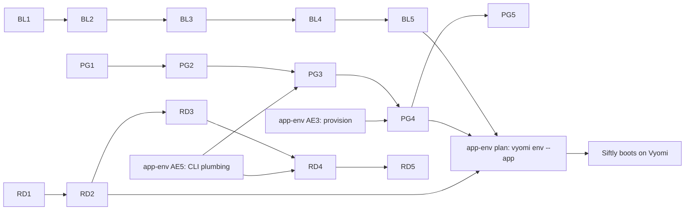

# Blob, Postgres + pgvector and Redis for Siftly — implementation plan

These three pieces get Siftly's web app, API and uploads running on Vyomi (step 1 in `siftly-integration-gaps.md`). They share no code with the Service Bus work, so they can run alongside it.

Estimates assume Claude writes the code and tests and the engineer reviews and runs them. Working days.

**CLI note.** None of the commands this plan uses exist today. Vyomi's shipped CLI is the compiled Go binary in `cmd/vyomi` (`dispatch.go` knows only `up`, `down`, `stop`, `restart`, `status`/`ps`, `logs`, `update`, `doctor`, `help`); `scripts/cloud-learn` is the legacy bash launcher. New commands go into the Go CLI only. `vyomi up` appends its arguments after the compose verb, so `vyomi up --profile app` would be rejected by Docker Compose; profiles are selected with `COMPOSE_PROFILES=app vyomi up` or a new `--with app` flag (app-env AE5).

## 1. Pull requests

### Blob (spec: `blob-storage-siftly-spec.md`)

| PR | Change | Files | Done when | Est. |
| --- | --- | --- | --- | --- |
| BL1 | Shared header model: `blob_content_headers(headers)` returns `content_type` (`x-ms-blob-content-type` > `Content-Type` > octet-stream) and cache-control, disposition, encoding, language | new helper in `core/azure_blob_core.py` (pure, Pyodide-safe), imported by the others | Unit tests for precedence and each header | 0.25 |
| BL2 | Apply it in all three paths: store `props`; return the headers on GET/HEAD and in list XML | `core/azure_blob_core.py` (PUT at line ~201, GET/HEAD/list); `core/azure_dataplane.py` (`_blob_handle` PUT, GET, HEAD, list; `put_blob_bytes`, `get_blob_rec`, `blob_props_rec`); `core/azure_blob_store.py` (`put_blob` `ContentSettings(...)` all fields; `get_blob`, `blob_props`, `list_blobs` read them back) | Core conformance cases 1–2 green on host and Pyodide; same results with Azurite on and off | 0.5 |
| BL3 | Container public-access level stored and returned | `core/azure_blob_core.py`, `core/azure_dataplane.py` (container PUT and get-properties); Azurite path stores the level as metadata on the container's marker blob in `core/azure_blob_store.py` (simulator containers are prefixes inside one Azurite container, so Azurite's own public access cannot be used) | Get-properties returns `x-ms-blob-public-access: blob` in both modes | 0.15 |
| BL4 | Azure XML error bodies for `ContainerNotFound`, `ContainerAlreadyExists`, `BlobNotFound` | `_error_xml` in `core/azure_dataplane.py` and `core/azure_blob_core.py` | Core conformance case 3 green; SDK still raises `ResourceExistsError` / `ResourceNotFoundError` | 0.25 |
| BL5 | SDK verification suite | new `tests/conformance/test_blob_siftly_sdk.py` (`azure-storage-blob`), run twice: in-process store and Azurite | Spec section 5, SDK cases 1–9, green in both modes. Browser-URL handling for the Docker target (spec R9) is built in app-env's endpoint resolver | 0.5 |
| | **Blob total** | | | **~1.65 d** (solo ~3 d) |

### Postgres + pgvector (spec: `postgres-pgvector-siftly-spec.md`)

| PR | Change | Files | Done when | Est. |
| --- | --- | --- | --- | --- |
| PG1 | Image `vyomi/postgres:16-alpine-pgvector` (build packages: `git build-base` only, because `with_llvm=no` needs no clang/llvm; `make OPTFLAGS="" with_llvm=no`) | new `packaging/postgres/Dockerfile`; new job in `.github/workflows/docker-publish.yml` (buildx, `linux/amd64,linux/arm64`, like the existing jobs) | Image builds on both architectures; `CREATE EXTENSION vector` works in a scratch container on both | 0.5 |
| PG2 | Compose switch with rollback variable | `docker-compose.yml`, `docker-compose.cloudlite.yml`, `docker-compose.appliance.yml`, `codespace/.devcontainer/docker-compose.sandbox.yml`: `image: ${VYOMI_POSTGRES_IMAGE:-vyomi/postgres:16-alpine-pgvector}`; add the image to any offline image list used by Docker installs (`scripts/verify-bundle.sh`) | Upgrade-in-place and rollback tests (spec §6 tests 1 and 6) pass | 0.25 |
| PG3 | `vyomi db` plumbing, `vyomi db dump` and `vyomi db refresh` (spec R5–R7). Role, database, `vector` and the grant are created by `vyomi app provision` (app-env AE3), not here | new Go subcommand in `cmd/vyomi` running `psql` / `pg_dump` **inside the Postgres container** (`docker exec` on Docker; `multipass exec` then `docker exec` on Multipass); no `psql` on the host. `db refresh`: two-pass materialized-view refresh and sequence reset, run after the data load | Spec §6 tests 2 and 5; dump works on both substrates | 0.25 |
| PG4 | `vyomi db restore` with dump cleaning (spec R4) | same Go subcommand: line-based cleaner driven by a pattern list (extensions, extension comments, all `OWNER TO`, Azure-role `GRANT`/`REVOKE`/`ALTER DEFAULT PRIVILEGES`, `public` schema statements, `SET transaction_timeout`, `MAINTAIN` privilege), cleaning log, pre-restore extension check; cleaned file moved with `multipass transfer` (Multipass) and `docker cp`, then restored **as role `siftly`** over the container's local socket with `psql -v ON_ERROR_STOP=1 -f`; `--dry-run` into a scratch database. **First task:** dry-run Siftly's real dump and add any new patterns | Spec §6 tests 3 and 4 | 0.75 |
| PG5 | Regression run | — | Spec §6 tests 1, 6, 7, 8 on amd64 and arm64 and on both substrates; Cloud SQL, RDS and Azure SQL conformance unchanged | 0.25 |
| | **Postgres total** | | | **~2 d** (solo ~3.5 d) |

### Redis (spec: `redis-siftly-spec.md`)

| PR | Change | Files | Done when | Est. |
| --- | --- | --- | --- | --- |
| RD1 | Real readiness for non-HTTP backends | `core/backend_provisioner.py` `_wait_for_ready`: prefer Docker health status `healthy`; else TCP connect to `container_name:<container port>` on the Docker network (the provisioner runs inside the simulator container; the port is parsed from the `recipe.ports` key, e.g. `int("6379/tcp".split("/")[0])`; each attempt catches `OSError`, covering DNS lag on a new container) until `health_timeout_s`; drop the fixed 5 s sleep | Unit test with a fake client; MySQL and DynamoDB still provision | 0.25 |
| RD2 | Compose service and recipe | `docker-compose.yml` (and `docker-compose.appliance.yml`, `docker-compose.cloudlite.yml`): `vyomi-redis`, `profiles: ["full","app"]`, `${VYOMI_REDIS_BIND:-127.0.0.1}:${VYOMI_REDIS_PORT:-36379}:6379` (Multipass launcher sets the VM address), AOF, no `maxmemory` by default (optional `VYOMI_REDIS_MAXMEMORY` with `noeviction`), optional `--requirepass`, `redis-cli ping` health check that sets `REDISCLI_AUTH` only when a password is set and greps `PONG`; compose volume with `name: vyomi-redis`; `VYOMI_REDIS_PASSWORD` passed to the simulator; `core/backend_provisioner.py` `Recipe("redis", …)` with the same volume name and a `127.0.0.1` port binding (extend `Recipe.ports` to accept a host IP) | Spec §5 tests 1, 2, 2a, 4, 8 | 0.4 |
| RD3 | Readiness gauge and runtime backends | `core/appliance_readiness.py`: add `("redis", "Redis", "vyomi-redis", 6379, "app", 30)`; `_active_backends()` counts category `app` only when `app` is in `COMPOSE_PROFILES` / `VYOMI_PROFILE`, or when its TCP probe currently succeeds (the module has no Docker client, so "container exists" is not checkable here); `routes/console.py` `runtime_backends()`: `redis` entry with a TCP probe | Gauge reaches 100% without Redis; Redis shows as available when running | 0.25 |
| RD4 | `vyomi redis flush` with password support (CLI plumbing from app-env AE5) | Go subcommand in `cmd/vyomi`: `redis-cli FLUSHALL` inside the Redis container, passing `REDISCLI_AUTH` only when non-empty; `docker exec` or `multipass exec` then `docker exec` | Spec §5 tests 7, 7a | 0.1 |
| RD5 | Verification script | new `tests/conformance/test_redis_siftly.py` | Spec §5 tests 3, 5 | 0.25 |
| | **Redis total** | | | **~1.25 d** (solo ~2.2 d) |

### Shared: CLI and env values

Moved to `app-env-implementation-plan.md`. The earlier CL1 (CLI plumbing) and EN1 (`vyomi env --map`) are replaced by its AE5 and AE1–AE11; creating the Postgres database, role and extension moves to its AE3; creating blob containers and starting Redis for the app are also done by AE3.

## 2. Order

The three tracks are independent. PG1 goes first in its track because the multi-architecture build is the main unknown.

## 3. Effort

| Track | With Claude | Solo |
| --- | --- | --- |
| Blob | 1.65 d | 3 d |
| Postgres + pgvector | 2 d | 3.5 d |
| Redis | 1.25 d | 2.2 d |
| Shared CLI and env | — (moved to `app-env-implementation-plan.md`) | — |
| **Total** | **~4.9 d** | **~8.7 d** |

PG3 and PG4 depend on the app-profile plan (AE5 for CLI plumbing, AE3 for provisioning). This total is higher than the ~2.5–3 days quoted before the reviews, because the review added the two other blob code paths, the error bodies, the dump cleaner, the provisioner readiness fix and the readiness-gauge handling. With Service Bus work running in parallel, a second engineer can take this whole plan.

## 4. Risks

| Risk | Effect | Mitigation |
| --- | --- | --- |
| pgvector fails to build on Alpine for one architecture | PG2 blocked | Build in PG1 before anything else; fallback `pgvector/pgvector:pg16` with a documented `REINDEX` |
| Dump cleaner misses an Azure-specific statement | Restore stops | `ON_ERROR_STOP=1` makes it visible; add the pattern to the cleaner and its test |
| `_wait_for_ready` change affects other backends | Provisioning regressions | RD1 runs MySQL and DynamoDB provisioning in the same test |
| Azurite ignores some content settings | Headers differ between modes | BL5 runs in both modes; document any Azurite gap |
| `vyomi env` overwrites a developer's custom values | Lost local settings | Handled in the app-profile plan (AE8 writes only the profile's keys and prints a diff) |
| Siftly image URLs do not load from a Dockerised backend | Broken images in the UI | Blob spec R9 (`host.docker.internal`) and `vyomi env --check` warning |
| Siftly skips deleting replaced images on non-Azure hosts | Orphan blobs locally | Known gap; one-line Siftly change suggested |
| Restoring as a non-superuser hits ownership or extension statements | Restore stops | Cleaner strips all `OWNER TO`, `COMMENT ON EXTENSION` and `CREATE EXTENSION`; `vyomi app provision` pre-creates `vector` |

## 5. Out of scope

Postgres 17 upgrade, the Helm chart's `postgres:15-alpine` drift, volume snapshots, blob chunked uploads and SAS verification, managed-cache control planes.

## 6. Review log

| Date | Finding | Change |
| --- | --- | --- |
| 2026-10-18 | `vyomi env`, `vyomi db`, `vyomi redis` do not exist; the shipped CLI is Go (`cmd/vyomi`) | CLI note; CL1 adds subcommand plumbing; db and redis commands are Go subcommands |
| 2026-10-18 | `vyomi up --profile app` is rejected: the CLI puts arguments after the compose verb | `vyomi up --with app` sets `COMPOSE_PROFILES` (CL1) |
| 2026-10-18 | `--app siftly` would hard-code a customer name into Vyomi | EN1 is generic: the app supplies a map file |
| 2026-10-18 | Restoring as the `siftly` role fails on `OWNER TO`, `COMMENT ON EXTENSION`; `CREATE EXTENSION vector` needs a superuser; Siftly's loader needs `session_replication_role` | Admin pre-creates `vector`; cleaner strips those statements; role gets `SET ON PARAMETER session_replication_role` |
| 2026-10-18 | Host `psql` would be needed on Windows/macOS | db commands run `psql` / `pg_dump` inside the Postgres container via `docker exec` |
| 2026-10-18 | Readiness module cannot check "container exists" | Count `app` backends when the profile is active or the TCP probe succeeds |
| 2026-10-18 | TCP readiness target unclear | Probe `container_name:<container port>` on the Docker network |
| 2026-10-18 | Redis `maxmemory 256mb` with no eviction would make writes fail when full | No limit by default; optional limit with `noeviction` |
| 2026-10-18 | pgvector build listed clang/llvm although `with_llvm=no` | Build packages reduced to `git build-base` |
| 2026-10-18 | Postgres track still built `vyomi db create` and counted CL1/EN1 | PG3 reduced to `db dump` and `db refresh`; provisioning via app-env AE3; shared row moved out of the total |
| 2026-10-18 | MV refresh and sequence reset ran before any data was loaded | Moved to `vyomi db refresh`, run after the data load (PG3) |
| 2026-10-18 | Unknown 17-only statements in the real dump | PG4 starts with a dry run of Siftly's real dump; pattern list extended (`MAINTAIN`, Azure default privileges, `public` schema) |
| 2026-10-18 | `db` commands assumed Docker | Multipass covered in PG3 and PG5 |
| 2026-10-18 | Shared CL1/EN1 table still listed after being superseded | Replaced by a pointer to the app-profile plan |
| 2026-10-18 | Redis compose and recipe volumes differ; recipe binds all interfaces; password in `ps` | RD2 (+0.1 d) and RD4 |
| 2026-10-18 | Blob URLs returned to the browser break with the Docker target | Blob spec R9; risk row |
| 2026-10-18 | Postgres container name differs between compose files | Postgres spec R7 |
| 2026-10-18 | External review (6 items): empty `REDISCLI_AUTH`, Azurite public access, port-key parsing, Multipass pipes, extension dependencies, stale CL1 reference | All valid; applied to RD1, RD2, RD4, BL3, PG4 and the CLI note. Multipass fix corrected to add `docker cp`; extension fix narrowed to what Siftly uses (`uuid-ossp`) |
| 2026-10-18 | App-env review: Redis unreachable on Multipass; `db`/`redis` need AE5's exec helper | `VYOMI_REDIS_BIND` in RD2; PG3/PG4/RD4 use the AE5 helper |
